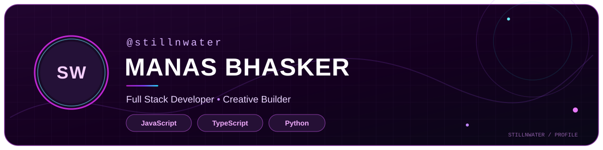
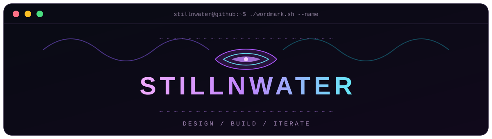
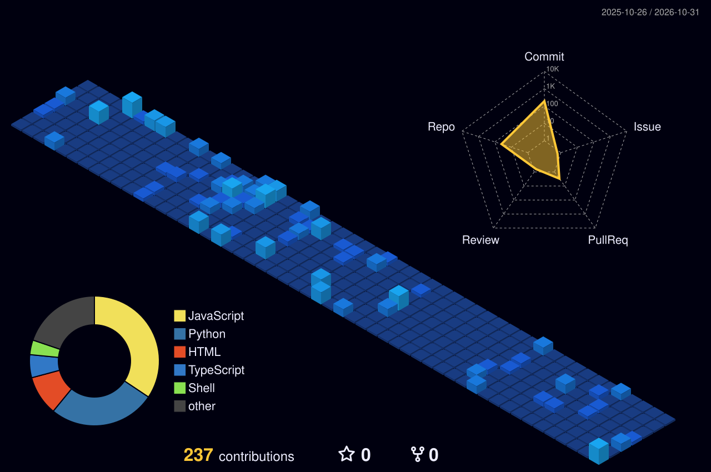

<picture>
  
</picture>

<picture>
  
</picture>

---

### ⚡ About Me

Hi, I'm **Manas Bhasker**, a **Full Stack Software Developer** based in **Delhi, India**.

I build and design whatever I can imagine.

If an idea pops into my head, chances are I'll build it to near perfection.

* 🎨 **Creative Design:** Skilled in **Canva** and **Figma** for UI prototyping, branding, and visual storytelling.
* ⚙️ **Core Engineering:** Strong foundation in **C++**, **OOP**.

---
## 🔗 Connect With Me

  
  </a>

---

### 🧰 Tech Stack

#### 🎨 Frontend

  
  
  
  
  
  

#### ⚙️ Backend

  
  
  
  
  

#### 🤖 AI / Data Science

  
  
  
  
  
  
  

#### ☁️ Hosting & Cloud

  
  
  

#### 🛠️ Tools & Platforms

  
  
  
  
  
  
  
  
  

## 📊 GitHub Overview

<table align="center" width="100%">
  <tr>
    <td align="center" width="50%">
      <h3>📊 Stats</h3>
      
    </td>
    <td align="center" width="50%">
      <h3>🔥 Streak</h3>
      
    </td>
  </tr>
</table>

## 🏆 GitHub Trophies

## ✨ Contribution Activity

<table align="center" width="100%">
  <tr>
    <td align="center" bgcolor="#0D1117">
      
    </td>
  </tr>
</table>

## 🧊 Isometric Contributions

  

---
